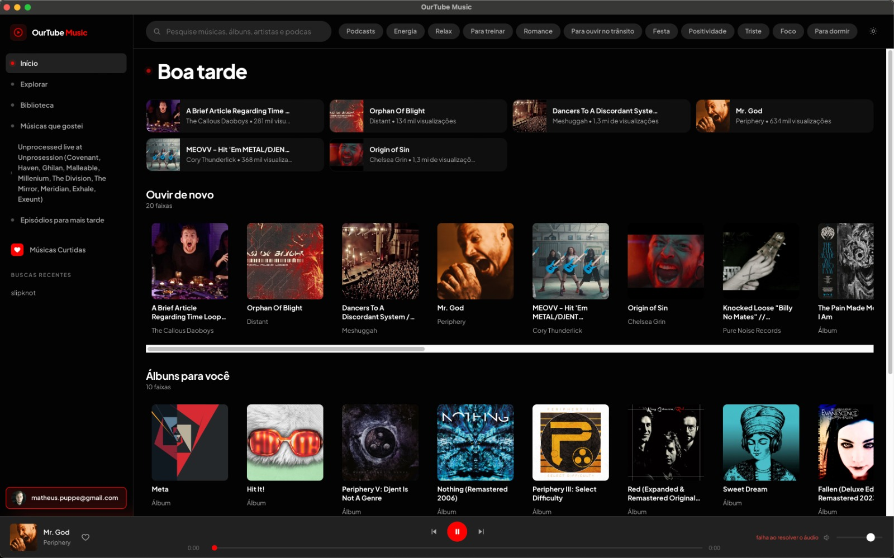

# OurTube Music



Leitor desktop (Tauri 2) do acervo público do YouTube Music, falando direto com os
endpoints internos (Innertube) que o site usa. O mapa veio de uma captura de rede
decifrada com `SSLKEYLOGFILE` em 05/11/2026.

## O que está mapeado

| Chamada             | Endpoint                                                                   | Cliente   |
| ------------------- | -------------------------------------------------------------------------- | --------- |
| Home                | `POST /youtubei/v1/browse` (`FEmusic_home`)                                | WEB_REMIX |
| Explorar/Biblioteca | `POST /youtubei/v1/browse` (`FEmusic_explore` / `FEmusic_library_landing`) | WEB_REMIX |
| Busca               | `POST /youtubei/v1/search`                                                 | WEB_REMIX |
| Fila / a seguir     | `POST /youtubei/v1/next`                                                   | WEB_REMIX |
| Stream de áudio     | `POST /youtubei/v1/player`                                                 | ANDROID   |
| Sugestões de busca  | `POST /youtubei/v1/music/get_search_suggestions`                           | WEB_REMIX |
| Navegação lateral   | `POST /youtubei/v1/guide`                                                  | WEB_REMIX |
| Conta               | `POST /youtubei/v1/account/account_menu`                                   | WEB_REMIX |

O `/player` do cliente WEB_REMIX devolve `UNPLAYABLE`; o cliente ANDROID devolve
URL direta do `googlevideo.com` no itag 18 progressivo (`Range` → `206 video/mp4`).
O AAC DASH do IOS (`ftypdash`) o WKWebView recusa no `<audio>`.

## Login (Google device flow)

O app entra com a conta Google sem capturar cookie: pede um código ao
`https://oauth2.googleapis.com/device/code` (client do YouTube TV, escopo
`.../auth/youtube`), mostra o código no modal e faz polling do
`https://oauth2.googleapis.com/token` com `grant_type=...device_code` até você
autorizar em `google.com/device`. O refresh token fica em
`<app-config-dir>/auth.json` com permissão `0600`; as chamadas Innertube passam
a levar `Authorization: Bearer <token>` e `X-Goog-AuthUser: 0`, então home,
biblioteca e player respondem já com a sua conta.

## Design

Interface no sistema **Obsidian Pulse**: preto absoluto (`#030303`), superfícies tonais,
acento vermelho `#ff0000`, Plus Jakarta Sans e dock de player em três módulos. Os tokens
morfam para o tema claro pelas mesmas variáveis CSS (`html[data-theme='light']`).

## Rodar

```bash
npm ci --include=dev
npm run tauri:dev        # janela desktop
npm run dev              # preview no browser (proxy em http://127.0.0.1:8794)
```

Gate de qualidade:

```bash
npm run ci && npm run rust:test
```

## TDD

- Rust: `src-tauri/tests/*.rs` — fixtures geradas com a crate `fake`, parsers puros.
- JS: `test/*.test.mjs` — `node:test` + `@faker-js/faker` (format, fila, bridge, upstream).

## Aviso

Uso pessoal. O app não baixa mídia, não contorna anúncio nem paywall; ele apenas reproduz
o que o player web reproduz. Respeite os termos do serviço.
